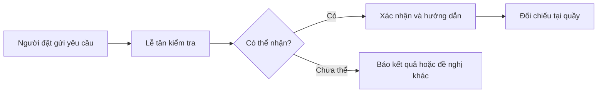

# Healthcare Portal — Hành trình người dùng

Cập nhật ngày 21/11/2026.

## 1. Mục đích và cách đọc

Báo cáo này mô tả việc người đặt, nhân viên điều phối và bác sĩ có thể trao đổi thông tin từ lúc phát sinh nhu cầu khám tới khi tiếp nhận tại quầy. Nó giúp làm rõ những bước cần nghiên cứu và cách giải pháp đang được hình dung. Các vai trò tham chiếu [User Personas](./user-personas.md), còn vấn đề và nhu cầu tham chiếu [Problem Statement](./problem-statement.md).

Cần phân biệt ba mức thông tin. **Hành trình tham chiếu** là quy trình một dịch vụ khác công bố. **Hiện trạng giả định** là những bước có thể có tại cơ sở mục tiêu, cần hỏi hoặc quan sát để kiểm tra. **Hiện trạng đã xác thực** chỉ được lập khi có nguồn trực tiếp phù hợp, ghi rõ bối cảnh, thời điểm và người tham gia. Hiện chưa có đủ dữ liệu để gọi bất kỳ hành trình nào dưới đây là hiện trạng đã xác thực của phòng khám mục tiêu.

Phần cuối trình bày **hành trình giải pháp đề xuất**, thường gọi là To-Be, để khám phá prototype. Nó được tách khỏi cách làm hiện tại, thường gọi là As-Is. Những điểm có thể gây khó khăn là giả thuyết; chưa có dữ liệu về cảm xúc, mức hài lòng, tỷ lệ bỏ cuộc hoặc thời gian chờ để gán vào từng bước.

## 2. Hai hành trình tham chiếu độc lập

### Người đặt qua CarePlus — RJ-01

Hướng dẫn [ứng dụng CarePlus — S13](https://app.careplusvn.com/) có cách đặt qua ứng dụng và hỗ trợ qua trò chuyện. Trong luồng được công bố, người đặt chọn bản thân hoặc thành viên gia đình, chọn cơ sở, chuyên khoa hoặc bác sĩ và thời gian, rồi nhận thông báo cùng chi tiết lịch. Dịch vụ cũng công bố khả năng đổi/hủy và kênh hỗ trợ.

Những bước này giúp đặt câu hỏi về việc ai thao tác, ai đi khám, người đặt dựa vào thông tin nào để biết kết quả và khi nào cần hỗ trợ. Tuy nhiên, điều kiện đổi/hủy cụ thể, cách duyệt nội bộ và toàn bộ khâu bàn giao tại quầy chưa được nguồn này mô tả đủ. Nguồn cũng chưa cho biết vì sao người dùng chọn kênh này hoặc có tiếp tục sử dụng hay không.

CarePlus là chuỗi phòng khám, chưa đại diện cho một cơ sở nhỏ độc lập. Không nên bổ sung quy trình của nhà cung cấp khác vào những chỗ thiếu rồi trình bày như đó là trải nghiệm CarePlus đã được quan sát.

### Nhân viên theo tài liệu KiotViet — RJ-02

[Hướng dẫn KiotViet — S11](https://www.kiotviet.vn/huong-dan-su-dung-kiotviet/salon-chuyen-nganh-phong-kham/giai-phap-quan-ly-phong-kham/), mục II.2 và IV.1–2, mô tả nhân viên chọn hoặc thêm khách, chọn dịch vụ, người phụ trách và tạo lịch. Tài liệu phân biệt lưu lịch với bắt đầu khám; phần di động có thao tác sửa và hủy.

Đây là ví dụ về cách phần mềm thể hiện công việc phía nhân viên, chưa phải một ca làm thực tế. Nguồn chưa xác nhận yêu cầu ban đầu đến từ đâu, ai có quyền quyết định, cách đối chiếu khi dữ liệu khác nhau và việc sửa lịch có cần báo hoặc ghi ở nơi khác không. Số thao tác trong hướng dẫn cũng chưa thể quy thành năng suất ca làm.

Hai hành trình tham chiếu này độc lập, không hàm ý CarePlus sử dụng KiotViet. BookingCare, Medpro và YouMed chỉ được dùng để đối chiếu câu hỏi: S01/S02 có hướng dẫn tại cơ sở và lưu ý về giờ hẹn; S04/S05 có luồng thanh toán và ngoại lệ; S07 có nhiều nội dung dành cho bệnh viện, còn S14 mô tả riêng Bình An. Điều kiện giữa các bối cảnh không được chuyển nguyên sang cơ sở mục tiêu. Chi tiết ở [phụ lục nguồn](./competitor-analysis.md#phu-luc-nguon).

## 3. Hiện trạng giả định cần nghiên cứu tại phòng khám

Các bước dưới đây là giả thuyết cho một cơ sở độc lập. Điện thoại, trò chuyện, sổ, bảng tính và phần mềm là những khả năng cần tìm hiểu, không phải khẳng định cơ sở đang sử dụng tất cả.

### Bước 1. Tìm cách sắp xếp khám — HJ-01

Người đặt tìm thông tin cơ sở, xác định ai sẽ đi khám và chọn cách liên hệ. Thông tin có thể đến từ website, người thân hoặc một kênh khác, nhưng chưa biết kênh nào được ưu tiên. Cần hỏi một lần lựa chọn gần nhất để hiểu điều gì khiến họ tự đặt hoặc nhờ hỗ trợ và họ đã chuẩn bị thông tin người khám như thế nào.

### Bước 2. Gửi và tiếp nhận yêu cầu — HJ-02

Người đặt đề nghị bác sĩ hoặc khoảng thời gian mong muốn; nhân viên tiếp nhận thông tin và kiểm tra khả năng nhận. Thông tin có thể đi từ cuộc gọi hoặc tin nhắn sang công cụ quản lý lịch, nhưng luồng cụ thể chưa được xác nhận. Cần ghi nơi nhân viên đọc, ghi và đối chiếu, ai có quyền quyết định, cũng như có bước chuyển hoặc nhập lại nào không.

### Bước 3. Biết kết quả yêu cầu — HJ-03

Sau khi xử lý, phòng khám phản hồi để người đặt biết có được nhận và khi nào cần đến. Kết quả có thể được báo qua cuộc gọi, tin nhắn, phiếu hoặc phần mềm; chưa biết cách nào được dùng tại cơ sở mục tiêu. Điều quan trọng cần nghiên cứu là dấu hiệu nào khiến người đặt hiểu rằng mình đã có lịch, và họ làm gì nếu thông tin vẫn chưa rõ.

### Bước 4. Đổi, hủy hoặc điều chỉnh ca bác sĩ — HJ-04

Người đặt có thể báo thay đổi kế hoạch, còn bác sĩ có thể báo thay đổi khả năng làm việc. Người điều phối cần nhận thông tin, đối chiếu khả năng tiếp nhận và trao đổi phương án với người liên quan. Cần truy lại một trường hợp thực tế để biết lịch cũ còn được hiểu là có hiệu lực tới khi nào, ai sửa và ai thông báo kết quả.

### Bước 5. Tới quầy tiếp nhận — HJ-05

Người bệnh tới cơ sở và nhân viên đối chiếu với lịch hiện có. Nếu người đặt khác người khám, cần biết phòng khám dùng thông tin nào để nhận đúng người. Nếu có khách trực tiếp, cần tìm hiểu cách cơ sở cân đối với người đã hẹn và ai quyết định khi kín lịch hoặc có người đến muộn. Chưa có dữ liệu để mô tả quy trình này như một cách làm đã được xác nhận.

### Bước 6. Kết thúc việc sắp xếp và lựa chọn lần sau — HJ-06

Người đặt cần biết việc sắp xếp đã kết thúc thế nào, còn cơ sở cần biết những yêu cầu nào đã xử lý. Sau trải nghiệm đó, người đặt có thể giữ hoặc đổi cách liên hệ vào lần sau, nhưng hiện chưa biết lý do và mức độ lặp lại. Cần hỏi kết quả thực tế, điều thuận lợi, điều chưa ổn và lý do giữ cách cũ thay vì suy ra mức hài lòng hay khả năng sử dụng lại.

Bác sĩ có thể chỉ báo lịch qua người điều phối. Chỉ nên thêm bước đăng nhập hoặc tự xem lịch vào hiện trạng khi có bằng chứng trực tiếp cho thấy công việc đó thực sự diễn ra.

## 4. Hành trình Healthcare Portal đang được đề xuất

Phần này có trạng thái **đề xuất cần kiểm chứng**. Để có một luồng cụ thể để khám phá, báo cáo xét phương án một cơ sở có lễ tân duyệt yêu cầu. Gửi yêu cầu chưa được xem là đã có lịch hay đã giữ chỗ. Quyền, khả năng tiếp nhận, thời hạn và chính sách xử lý còn cần xác nhận trước khi chốt thiết kế chi tiết.

**Luồng chính để đọc nhanh — phương án cần kiểm chứng:**

Đọc theo chuỗi **gửi yêu cầu → kiểm tra → nhận kết quả → tới quầy**. Đổi/hủy và bác sĩ đổi ca là các nhánh phát sinh; theo dõi kết quả và bàn giao diễn ra xuyên suốt.

### Bước 1. Gửi yêu cầu — TJ-01

- **Ai tham gia:** Người đặt, có hỗ trợ từ lễ tân khi cần.
- **Kết quả cần kiểm tra:** Thông tin vào hàng chờ và người đặt biết mình chưa có lịch xác nhận.

Người đặt chọn đúng người khám, bác sĩ hoặc khung thời gian và gửi thông tin qua portal; người cần trợ giúp có thể liên hệ nhân viên. Thông tin đi vào phần chờ xử lý của lễ tân, bao gồm người đặt, người khám, liên hệ và khung đề nghị. Kết quả cần nói rõ yêu cầu đang chờ xác nhận. Khi thử, cần xem người đặt có nhập nhầm người, gửi lặp hoặc hiểu thông báo này như đã có lịch không. Bước này gắn với nhu cầu N01 và N04.

### Bước 2. Kiểm tra và xử lý yêu cầu — TJ-02

- **Ai tham gia:** Lễ tân/người điều phối.
- **Kết quả cần kiểm tra:** Có quyết định nhận hoặc không nhận dựa trên khả năng hiện tại.

Lễ tân xem yêu cầu cùng ca làm và khả năng tiếp nhận, rồi quyết định nhận hoặc không nhận. Nhân viên cũng có thể ghi yêu cầu từ điện thoại hoặc quầy để đối chiếu trên cùng luồng đang được thử. Thiết kế cần thể hiện trường hợp khả năng nhận vừa thay đổi, ca không còn mở hoặc yêu cầu không còn phù hợp; không âm thầm chuyển người đặt sang giờ khác. Bước này đáp ứng nhu cầu N02.

### Bước 3. Hiểu lịch đang áp dụng — TJ-03

- **Ai tham gia:** Người đặt và người được đặt hộ.
- **Kết quả cần kiểm tra:** Hiểu lịch đang áp dụng, ý nghĩa giờ hẹn và bước tiếp theo.

Người đặt xem kết quả và chi tiết hiện hành để biết còn chờ hay đã được nhận, giờ hẹn có nghĩa gì và cần làm gì khi tới cơ sở. Nếu đặt hộ, thông tin này còn cần được chuyển cho người đi khám. Khi thử, cần phân biệt thông báo đã gửi yêu cầu với thông báo xác nhận, đồng thời xem người đặt có nhầm giờ hẹn với giờ bắt đầu khám không. Đây là phần kiểm tra nhu cầu N01.

### Bước 4. Đề nghị đổi hoặc hủy — TJ-04

- **Ai tham gia:** Người đặt và người điều phối.
- **Kết quả cần kiểm tra:** Phân biệt đề nghị đổi với lịch hiện hành, biết kết quả đổi/hủy.

Người đặt gửi đề nghị thay đổi; nhân viên xem xét theo khả năng tiếp nhận và điều kiện cơ sở. Phương án đang cân nhắc là hiển thị đề nghị đổi riêng với lịch đang áp dụng, để việc đổi không thành công không làm người đặt mất lịch cũ còn khả dụng. Nếu hủy khi đang chờ đổi, kết quả phải rõ và đề nghị cũ không tiếp tục làm người dùng hiểu rằng còn lịch. Điều kiện và quyền hủy vẫn cần được xác nhận. Bước này gắn với N03.

### Bước 5. Xử lý bác sĩ nghỉ hoặc đổi ca — TJ-05

- **Ai tham gia:** Bác sĩ báo thay đổi; người điều phối xử lý.
- **Kết quả cần kiểm tra:** Các lượt bị ảnh hưởng có người liên hệ và thông tin lịch được làm rõ.

Bác sĩ báo thay đổi cho người điều phối; nhân viên xác định các lượt bị ảnh hưởng, ngừng nhận thêm ở ca không còn khả dụng và liên hệ người đặt để sắp xếp lại. Người đặt cần biết lịch cũ không còn dùng để đến khám và ai đang xử lý. Không nên tự chuyển bác sĩ hoặc giờ mà khiến người đặt tưởng mình đã đồng ý. Đây là phương án cho nhu cầu N03 và N05, chưa phải chính sách cơ sở đã chốt.

### Bước 6. Tiếp nhận tại quầy — TJ-06

- **Ai tham gia:** Người đến khám và nhân viên tại quầy.
- **Kết quả cần kiểm tra:** Đối chiếu đúng người/lượt, ghi nhận tiếp nhận và giờ đến.

Nhân viên tìm lịch hiện hành, đối chiếu mã và người khám, rồi ghi nhận đã tiếp nhận cùng giờ đến thực tế. Người đến trực tiếp cũng cần được xem xét trong khả năng nhận chung, thay vì được thêm vào mà không kiểm tra. Khi thử, cần có trường hợp dùng chung số liên hệ, đến muộn và kín lịch. Nhãn tiếp nhận không được khiến người dùng hiểu là đã khám. Bước này liên quan N02 và N04.

### Bước 7. Theo dõi kết quả và bàn giao — TJ-07

- **Ai tham gia:** Người điều phối và người đặt.
- **Kết quả cần kiểm tra:** Biết kết quả hiện tại và việc nào còn phải liên hệ.

Lịch sử và thông tin kết quả giúp nhân viên biết việc nào còn cần liên hệ, còn người đặt biết lịch nào đang áp dụng. Cần phân biệt đã gửi thông báo, đã liên hệ và người đặt đã đồng ý. Việc gửi lỗi hoặc chưa liên hệ được không tự làm thay đổi kết quả nghiệp vụ. Công việc này gắn với N03 và diễn ra cùng các bước xử lý, không phải chỉ chờ tới sau khi người bệnh đến quầy.

## 5. Những ngoại lệ cần thể hiện khi khám phá giải pháp

- **Tranh chỗ hoặc đổi sang giờ đã kín.** Khi hai yêu cầu cạnh tranh cùng khả năng tiếp nhận, cần cho người xử lý biết thông tin đã thay đổi và làm rõ yêu cầu nào được nhận. Người còn lại không nên thấy một giờ mới mà không biết đó chỉ là đề nghị. Tương tự, khi giờ xin đổi đã kín, phương án cần thử là giữ rõ lịch cũ còn khả dụng và kết quả đổi không thành công.

- **Hủy khi đang đổi hoặc bác sĩ nghỉ.** Nếu hủy trong lúc chờ đổi, kết quả hủy và đề nghị đổi phải nhất quán để phản hồi cũ không làm lịch như xuất hiện trở lại. Khi bác sĩ nghỉ, cần có danh sách các lượt cần xử lý và hướng dẫn liên hệ. Nếu khách đã được tiếp nhận, thông tin đó cần được giữ để nhân viên giải quyết tại quầy thay vì tự chuyển người khám hoặc xóa dấu vết.

- **Đến trực tiếp, đến muộn và đặt hộ.** Khách trực tiếp, người đến ngoài khung và người đặt hộ cần có cách đối chiếu rõ. Việc dùng chung số liên hệ không được làm hai người khám bị gộp thành một người hoặc mở quyền xem thông tin ngoài phạm vi. Khi kín lịch, người điều phối cần giải thích và cân nhắc phương án khác theo khả năng thực tế.

- **Chờ quá giờ, gửi lặp hoặc thông báo lỗi.** Với yêu cầu chưa được duyệt tới giờ dự kiến, cần làm rõ cách kết thúc và thông báo rằng chưa có lịch xác nhận; quy định hết hạn chưa được cơ sở chốt. Gửi lặp cần tránh tạo nhiều yêu cầu ngoài ý muốn. Nếu thông báo thất bại, cần thể hiện việc còn phải liên hệ và không đồng nhất gửi thành công với đã đọc hoặc chấp thuận.

## 6. Ưu tiên nghiên cứu tiếp

Nên ưu tiên kiểm tra cách người đặt phân biệt chờ và xác nhận, cách hiểu lịch khi có thay đổi, rồi công việc phân bổ và tiếp nhận của nhân viên. Chưa có dữ liệu để xếp hạng theo tỷ lệ bỏ cuộc hoặc gọi đây là cải tiến đã chứng minh hiệu quả.

Dùng phần hiện trạng giả định để chuẩn bị [phỏng vấn](../03-interview-guide.md), còn phần giải pháp đề xuất và ngoại lệ để chuẩn bị thử tác vụ. Khi có bằng chứng trực tiếp, cập nhật lại bước, nguồn, thời điểm và cả phản chứng. Bộ báo cáo hiện chưa chốt mô hình trạng thái hoặc phạm vi MVP; quyền, công suất, đổi/hủy và thông báo vẫn cần được xác nhận cùng người vận hành.
